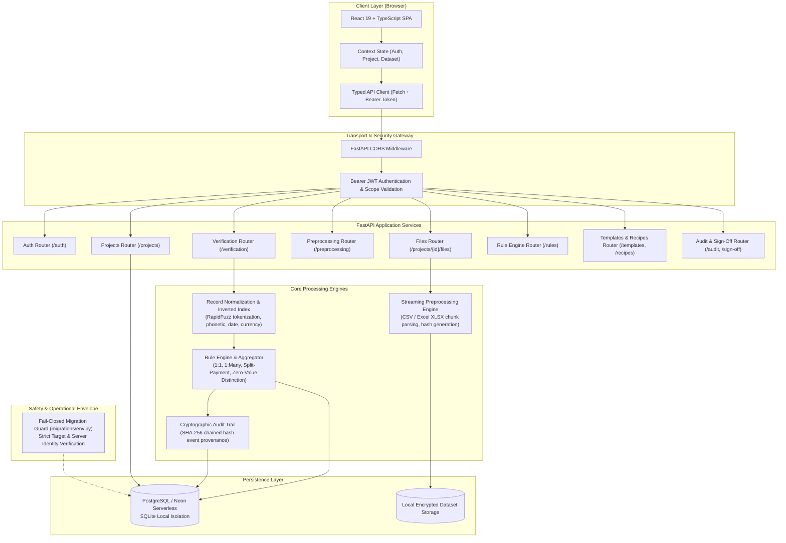
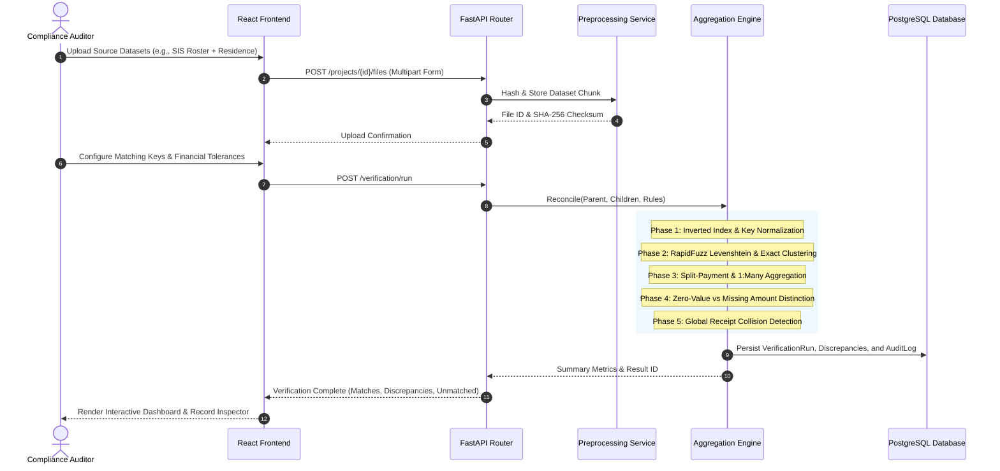
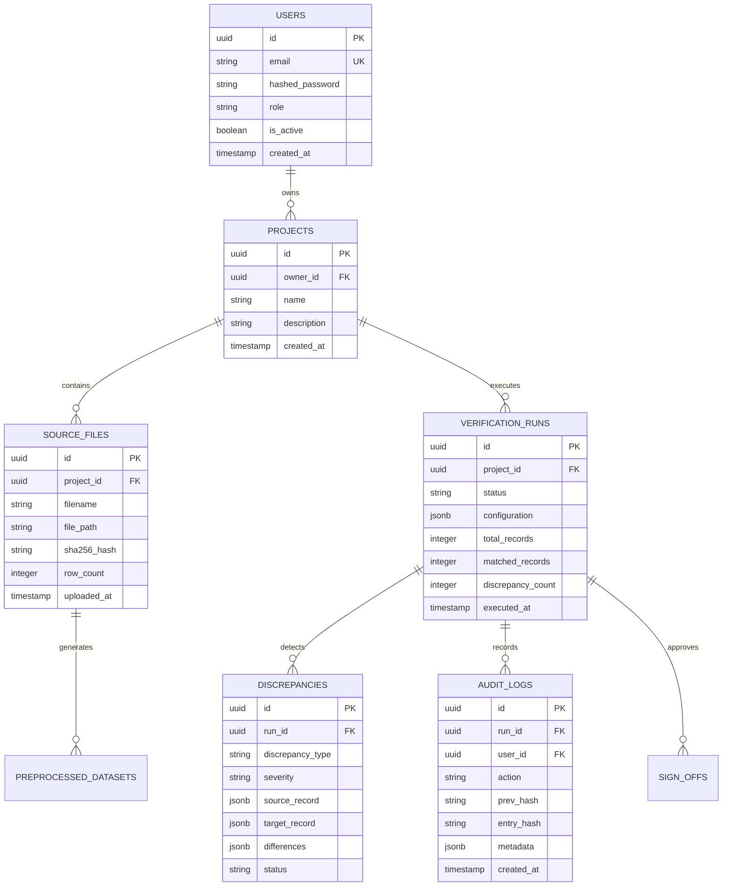

# VerifyGrid System Architecture

This document provides a comprehensive technical overview of VerifyGrid's system architecture, detailing the end-to-end data flow, frontend client structure, backend service decomposition, database lineage, and fail-closed migration safeguards.

---

## 1. High-Level Architecture Overview

VerifyGrid is an enterprise-grade multi-source reconciliation, discrepancy detection, and cryptographic audit platform designed for financial, academic, and administrative record auditing.



---

## 2. Frontend Client Architecture

The frontend is built with **React 19.2**, **TypeScript 6.0**, and **Vite 8.3**. It is structured as an interactive single-page application (SPA) focused on clarity, responsiveness, and resilient error recovery.

### Component Decomposition

```
frontend/src/
├── components/
│   ├── AuthScreen.tsx           # Institutional authentication & self-registration
│   ├── Sidebar.tsx              # Workspace navigation, tenant switching, system status
│   ├── ProjectsView.tsx         # Audit workspace management, creation, dataset inspection
│   ├── ReconciliationWizard.tsx  # Multi-step reconciliation workflow:
│   │                            #   Step 1: File upload & schema profiling
│   │                            #   Step 2: Candidate column mapping & key selection
│   │                            #   Step 3: Verification rule & tolerance definition
│   │                            #   Step 4: Execution trigger & progress monitoring
│   ├── VerificationResults.tsx  # Reconciliation metrics, discrepancy categorisation
│   ├── RecordInspector.tsx      # Side-by-side discrepancy comparator & audit drawer
│   ├── QuarantineView.tsx       # Quarantined & unmapped record resolution table
│   ├── BulkReviewModal.tsx      # Cluster-based bulk sign-off and review workflows
│   ├── AuditHistoryView.tsx     # Cryptographic audit log viewer & hash verification
│   └── AppearanceControl.tsx    # Theme, accessibility, and high-contrast controls
├── context/
│   ├── AuthContext.tsx          # JWT token lifecycle, refresh, and session expiration
│   └── authContextDef.ts        # Context types and interface contracts
├── services/
│   └── api.ts                   # Centralized typed HTTP client with Bearer auth injection
└── types/
    └── index.ts                 # End-to-end domain interfaces matching backend Pydantic schemas
```

### State Management & Lifecycle

- **Authentication State (`AuthContext`):** Tokens are securely stored in browser local storage under `verifygrid_token`. Network requests automatically inject `Authorization: Bearer <token>`. Interceptors catch `401 Unauthorized` responses and cleanly transition the user to the login screen without losing unsaved project identifiers.
- **Dataset Workspace State (`ReconciliationWizard`):** Manages multi-file metadata, selected worksheet tabs for Excel workbooks (`.xlsx`), custom header rows for spreadsheets with preamble banners, and streaming upload states.
- **Side-by-Side Record Comparison:** Discrepancies are categorized into exact matches, partial matches, missing child/parent keys, and tolerance breaches. Clicking any record loads its full field lineage into `RecordInspector.tsx`.

---

## 3. Backend Service Architecture

The backend is built with **FastAPI 0.143**, **SQLAlchemy 2.1 (2.0-style)**, and **Pydantic 2.14**. It follows a decoupled service-layer pattern where routers delegate complex domain calculations to dedicated service engines.

### Router Decomposition

| Router Module | Mount Point | Core Responsibilities |
|---|---|---|
| `app.routers.auth` | `/api/v1/auth` | User registration, login, JWT token generation, `/me` profile inspection. |
| `app.routers.projects` | `/api/v1/projects` | Multi-tenant workspace creation, listing, updating, and project-level RBAC. |
| `app.routers.files` | `/api/v1/projects/{id}/files` | Chunked file upload, format validation, streaming storage, SHA-256 integrity hashing. |
| `app.routers.preprocessing` | `/api/v1/preprocessing` | Schema profiling, automated data type inference, duplicate row detection, column recommendations. |
| `app.routers.verification` | `/api/v1/verification` | Multi-source reconciliation execution, discrepancy list generation, side-by-side inspection. |
| `app.routers.rules` | `/api/v1/rules` | Reconciliation rule authoring, validation, preview against sample data, fuzzy threshold tuning. |
| `app.routers.templates` | `/api/v1/templates` | Higher-education and enterprise reconciliation templates (Tuition vs Bursar, Payroll vs GL). |
| `app.routers.recipes` | `/api/v1/recipes` | Parameterized verification recipe storage, execution, and versioning. |
| `app.routers.audit` | `/api/v1/audit` | Cryptographic audit trail logging, SHA-256 chained hash verification, sign-off state transitions. |
| `app.routers.health` | `/api/v1/health` | Service liveness, readiness probes, and database ping verification (`/health/db`). |

---

## 4. Verification & Processing Pipeline



---

## 5. Database Architecture & Schema Lineage

### Primary Entities & Relationships



### Multi-Engine Persistence Strategy
- **Production Persistence:** PostgreSQL / Neon Serverless (with connection pooling via PgBouncer or direct pool).
- **Local Isolated Development:** SQLite compatibility (`sqlite:///demo.db`) enables frictionless offline development, hermetic testing, and screenshot capture without establishing remote connections.

---

## 6. Migration Safeguards & Operational Security

VerifyGrid implements an explicit, fail-closed database migration guard located in `backend/migrations/env.py`.

### Safeguard Principles
1. **Target Identity Validation:** Verifies that connection URLs, hostname endpoints, and server variables match approved staging or production configurations.
2. **Production Endpoint Isolation:** Staging environments are structurally prohibited from connecting to either hardcoded production endpoints or dynamically configured production endpoints.
3. **Transaction Ownership Safety:** Caller-owned transactions are strictly preserved. The migration guard never calls `rollback()` or `commit()` on connections where a caller transaction was already active, ensuring zero unintended state rollbacks.
4. **Neon Serverless Identity Checks:** When connecting to cloud Postgres instances, the guard inspects server endpoint identities (`SHOW neon.project_id` / server parameters) to prevent misdirected migrations.
