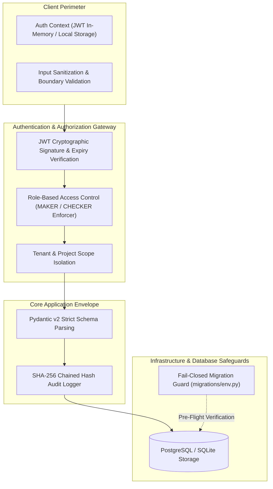
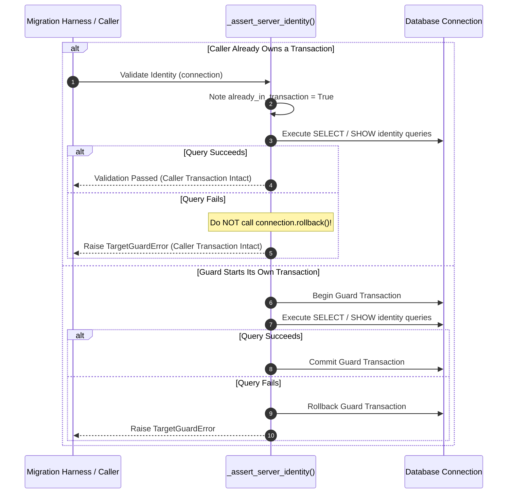
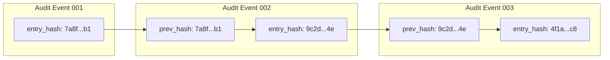

# VerifyGrid Security & Operational Safeguards

This document details the security architecture, authorization controls, cryptographic integrity mechanisms, and fail-closed operational safeguards implemented across VerifyGrid.

---

## 1. Security Architecture Overview

VerifyGrid is designed to handle sensitive organizational and financial data across education, enterprise, and public sector contexts. Its security posture is anchored in zero-trust principles:

---

## 2. Authentication & Role-Based Access Control (RBAC)

### 2.1 Maker-Checker Governance Model
VerifyGrid implements an institutional **Maker-Checker** governance model to enforce strict separation of duties during compliance audits and financial reconciliations:

- **MAKER (Auditor / Preparer):**
  - Permitted to create projects, upload raw datasets, run reconciliation pipelines, and propose review decisions.
  - **Prohibited** from approving sign-offs, closing audit findings, or modifying governance policies.
- **CHECKER (Supervisor / Lead Auditor):**
  - Permitted to inspect discrepancy clusters, review audit histories, and formally approve or reject sign-offs.
  - Guarantees that no single operator can prepare, execute, and certify a financial reconciliation without independent supervisory verification.

> [!IMPORTANT]
> **Registration Principle:** Public user self-registration (`POST /api/v1/auth/register`) unconditionally defaults to the `MAKER` role. The `role` attribute is strictly immutable from client requests, query parameters, or token claims. Privileged `CHECKER` roles can only be granted through administrative directory synchronization or supervisory provisioning.

### 2.2 JWT Bearer Token Security
- **Algorithm:** HMAC-SHA256 (`HS256`) with ephemeral or securely injected secret keys.
- **Claims Verification:** Tokens carry subject UUID (`sub`), email address, and issuance timestamps. Expiry (`exp`) is enforced on every authenticated call.
- **Session Termination:** Invalidation is handled through explicit token eviction and client-side broadcast events (`auth:unauthorized`), preventing lingering authenticated states.

---

## 3. Fail-Closed Database Migration Guard

To eliminate the catastrophic risk of schema migrations or development scripts inadvertently running against production databases, VerifyGrid implements an explicit, fail-closed validation guard in `backend/migrations/env.py`.

### 3.1 Protection Dimensions
1. **Target Identification:** Analyzes the target database URL to classify the environment into `PRODUCTION`, `STAGING`, or `LOCAL_DEVELOPMENT`.
2. **Neon Serverless Endpoint Verification:** When targeting Neon PostgreSQL, the guard connects and queries server-level identity variables (`SHOW neon.project_id`, `SHOW server_version`) to confirm that the physical database endpoint matches the authorized host.
3. **Staging vs. Production Endpoint Isolation (Audit Correction F-06B):** Staging validation strictly rejects both the hardcoded known production endpoint and any dynamically configured production endpoint (`PRODUCTION_DATABASE_URL` / `PRODUCTION_ENDPOINT_ID`). Staging credentials cannot execute against production infrastructure under any circumstances.
4. **Target-Bound Acknowledgement:** Applying migrations to production requires explicit, simultaneous confirmation flags:
   - Environment variable: `VERIFYGRID_TARGET=production`
   - Explicit acknowledgement: `VERIFYGRID_ACKNOWLEDGE_PRODUCTION_MIGRATION=true`

### 3.2 Transaction Ownership Safety (Audit Correction F-06A)

- If the caller already owns a transaction, the guard **never** invokes `connection.rollback()` or `connection.commit()`. Unrelated caller work is never disrupted or rolled back by pre-flight checks.
- If the guard initiates a transaction for identity probing, it guarantees deterministic cleanup on all success and exception paths.

---

## 4. Cryptographic Audit Trail & Tamper Evident Logging

Reconciliation outcomes and supervisory sign-offs are backed by a cryptographically verifiable audit trail (`backend/app/models/audit_log.py`).

### 4.1 Chained Hash Architecture
Every audit event generates a tamper-evident cryptographic block containing:
- `entry_id`: Unique UUIDv4 identifier.
- `run_id`: Associated reconciliation run.
- `user_id`: Operator responsible for the action.
- `action`: Specific state change (e.g., `RUN_EXECUTED`, `DISCREPANCY_REVIEWED`, `SIGN_OFF_PROPOSED`, `SIGN_OFF_APPROVED`).
- `prev_hash`: SHA-256 digest of the immediately preceding audit event in the project chain.
- `entry_hash`: SHA-256 digest computed across `(prev_hash + run_id + user_id + action + timestamp + metadata_canonical_json)`.

### 4.2 Tamper Detection
- Any retroactive alteration of a past discrepancy classification, timestamp, or sign-off decision alters that event's `entry_hash`.
- This invalidates the `prev_hash` pointer of all downstream events, causing automated integrity checks (`GET /api/v1/audit/{run_id}/verify`) to fail with exact pointer divergence diagnostics.

---

## 5. Local Isolation & Offline Execution Safeguards

To prevent inadvertent cloud connections during testing and presentation generation:
- **Default Database Isolation:** When running tests or demo captures locally, `DATABASE_URL` is configured to SQLite (`sqlite:///demo.db`).
- **Hermetic Test Harness:** The test suite disables remote network sockets for integration tests unless explicitly invoked with the `-m postgres` marker against a verified local loopback PostgreSQL instance.
