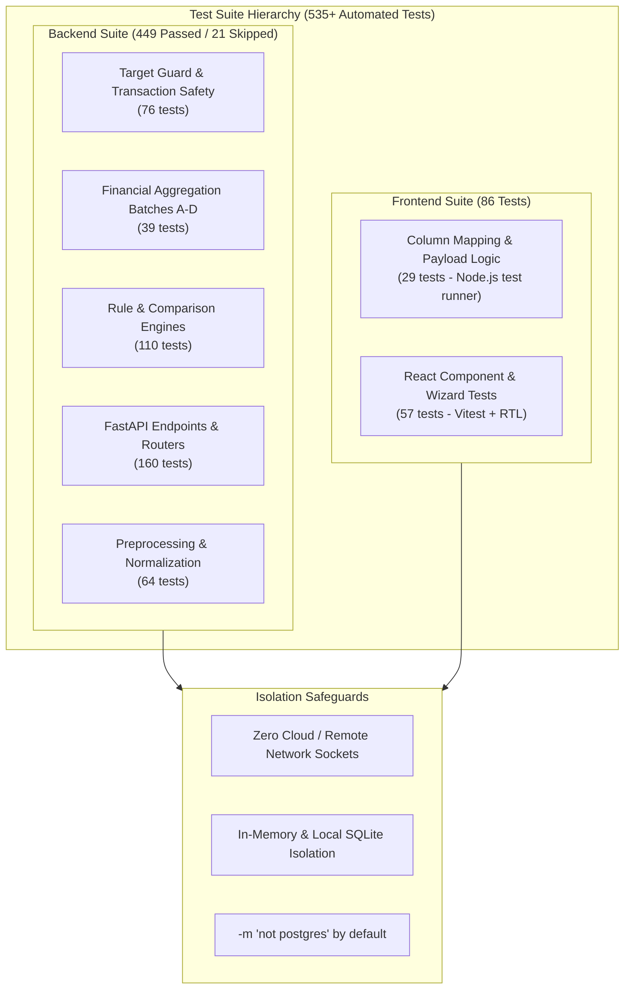

# VerifyGrid Testing Strategy & Verification Guide

This document describes the testing architecture, test matrix, isolation safeguards, and exact reproduction commands for verifying VerifyGrid across backend and frontend codebases.

---

## 1. Testing Philosophy & Quality Standard

VerifyGrid follows an empirical, zero-fabrication testing standard. All claims, metrics, and reconciliation algorithms are backed by comprehensive, reproducible automated test suites.



---

## 2. Test Execution Matrix & Quick Reference

> [!NOTE]
> The automated suite comprises **535 distinct passing tests**: **449 backend tests** (with 21 live-PostgreSQL integration tests skipped offline) and **86 frontend tests** (29 logic + 57 component tests). The Target Guard (76 tests) and Financial Aggregation (39 tests) suites are focused regression modules executed within the 449 backend suite, not additive counts.

| Test Suite | Command | Execution Time | Passed | Skipped | Scope |
|---|---|---|---|---|---|
| **Backend Core (Offline)** | `pytest backend/tests -m "not postgres"` | ~25 s | **449** | 21 | Full backend excluding live PostgreSQL integration. |
| **Migration Target Guard (Subset)** | `pytest backend/tests/test_migration_env_guard.py` | ~1.8 s | **76** | 0 | Strict endpoint identity, staging isolation, transaction safety. |
| **Financial Aggregation (Subset)** | `pytest backend/tests/test_financial_aggregation_batches_a_d.py` | ~1.2 s | **39** | 0 | Batches A–D: duplicate parents, valid zero vs null, sentinels, payment flags. |
| **Frontend Full Suite** | `cd frontend && npm test` | ~5.5 s | **86** | 0 | Combined logic (29) and component (57) suites. |
| **Frontend Logic Suite** | `cd frontend && npm run test:logic` | ~0.8 s | **29** | 0 | Column mapping heuristics, fuzzy synonym matching, payload construction. |
| **Frontend Component Suite** | `cd frontend && npm run test:components` | ~4.7 s | **57** | 0 | React 19 UI components, wizard navigation, error boundaries. |

---

## 3. Backend Test Architecture

The backend test suite is structured under `backend/tests/` and built on **pytest** and **pytest-mock**:

### Key Test Suites

1. **Target Guard & Transaction Safety (`test_migration_env_guard.py` — 76 tests):**
   - Validates hostname classification (loopback, staging, production, generic PostgreSQL).
   - Validates Neon server identity queries (`SHOW neon.project_id`, `SHOW server_version`).
   - Verifies that staging configurations strictly reject both hardcoded and dynamically configured production endpoints (**Audit Correction F-06B**).
   - Verifies that caller-owned transactions are never committed or rolled back by pre-flight identity checks (**Audit Correction F-06A**).
   - Demonstrates deterministic cleanup of guard-initiated transactions.

2. **Financial Aggregation Correctness (`test_financial_aggregation_batches_a_d.py` — 39 tests):**
   - **Batch A (Duplicate Parent Keys):** Tests that duplicate parent rows are preserved with distinct row indices, grouped, and classified as `AMBIGUOUS_PARENT` without silent overwriting.
   - **Batch B (Valid Zero Amounts):** Tests that `$0.00` balances successfully reconcile against legitimate zero payments, while missing, empty, or corrupt values produce critical data integrity discrepancies.
   - **Batch C (Orphan Sentinel Safety):** Tests collision safety when legitimate parent business identifiers equal `"__ORPHAN__"`.
   - **Batch D (Payment Flags & Receipt Registry):** Tests `allow_partial_payment` and `allow_overpayment` flag semantics, ensuring double-counting of receipt amounts is intercepted.

3. **Preprocessing & Parsing (`test_preprocessing.py`, `test_profiling.py` — 64 tests):**
   - Header row detection, sheet selection, column type inference (currency, date, numeric, text), chunked hashing.

4. **API Router Endpoints (`test_auth_endpoints.py`, `test_projects.py`, `test_verification_router.py` — 160 tests):**
   - Role-based permissions, JWT authentication enforcement, payload validation, side-by-side inspection responses.

---

## 4. Frontend Test Architecture

The frontend uses a dual-layer testing approach:

### 4.1 Logic Suite (Node.js Native Test Runner)
- **Path:** `frontend/tests/*.test.ts`
- **Execution:** `node --test "tests/*.test.ts"`
- **Focus:** Fast, hermetic validation of business algorithms without DOM overhead:
  - `columnMapping.test.ts`: Canonical attribute collection, candidate key scoring, fuzzy synonym heuristics.
  - `fieldOwnership.test.ts`: Multi-source payload construction, field conflict resolution.

### 4.2 Component Suite (Vitest + React Testing Library)
- **Path:** `frontend/src/**/*.test.tsx`
- **Execution:** `vitest run`
- **Focus:** User interaction, rendering states, and accessibility:
  - `AuthScreen.test.tsx`: Form validation, error alert displays, token storage.
  - `ReconciliationWizard.test.tsx`: 5-step navigation, file drag-and-drop, step jumping.
  - `Sidebar.test.tsx`: Tenant navigation, active tab highlights, mobile drawer toggle.
  - `RecordInspectorDrawer.test.tsx`: Side-by-side comparison, field difference highlighting.

---

## 5. Local Reproduction Guide

### Run Backend Tests

```bash
# 1. Activate backend environment
cd backend
source venv/bin/activate  # On Windows: .venv\Scripts\Activate.ps1

# 2. Run all non-PostgreSQL tests (safe, offline)
pytest tests -m "not postgres"

# 3. Run target guard tests specifically
pytest tests/test_migration_env_guard.py -v

# 4. Run financial aggregation correctness tests specifically
pytest tests/test_financial_aggregation_batches_a_d.py -v
```

### Run Frontend Tests

```bash
# 1. Navigate to frontend
cd frontend

# 2. Install dependencies (if not already installed)
npm install

# 3. Run full test suite (logic + components)
npm test

# 4. Run individual test suites
npm run test:logic
npm run test:components
```
